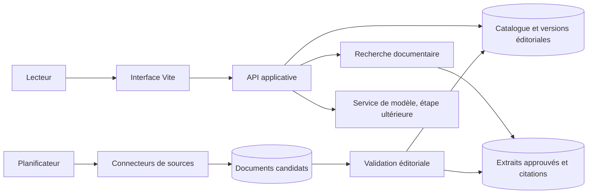

# Cadrage technique

## Objectif et état actuel

IAeVolution est aujourd'hui un site statique servi et construit par Vite. Les dossiers,
les réponses de l'assistant et le catalogue `sources.json` sont éditorialisés dans le
dépôt. Il n'existe ni API, ni base de données, ni collecte programmée, ni appel à un
modèle génératif.

Le cap proposé est d'évoluer par étapes vers un observatoire traçable et révisable, sans
confondre une page publiée avec une veille automatisée. La validation éditoriale reste un
acte humain ; l'automatisation prépare et signale les changements, mais ne publie pas de
faits sensibles de sa propre initiative.

## Architecture cible, par responsabilités

Ce schéma est logique, pas un choix d'hébergeur ni une architecture déjà déployée. Le
prototype ne doit pas appeler directement un fournisseur de modèle depuis le navigateur.

### Interface

- Conserver Vite et l'expérience actuelle pendant le cadrage et le premier MVP.
- Consommer une API versionnée lorsque le catalogue sortira du dépôt.
- Rendre explicites les états de chargement, de source indisponible et de corpus incomplet.
- Ne jamais embarquer de secret, clé fournisseur ou identifiant d'accès dans les assets web.

### Catalogue éditorial et historique

`sources.json` constitue le premier contrat de données. À terme, conserver les identifiants
stables, mais séparer les concepts suivants :

| Entité | Rôle et champs clés |
|---|---|
| `Source` | Organisme, famille, sujets couverts, cadence souhaitée, URL autorisées, statut éditorial |
| `SourceDocument` | Document concret : URL, titre, éditeur, date de publication, type, langue et empreinte du contenu |
| `DocumentVersion` | Empreinte, date de collecte, emplacement éventuel du document et changements détectés |
| `Evidence` | Extrait précisément localisable, document/version d'origine, page ou section, statut de validation |
| `EditorialClaim` | Affirmation publiée, portée, unité, période, qualificatif (fait, estimation, projection), preuves associées |
| `ReviewEvent` | Qui a vérifié quoi, quand, décision et commentaire ; journal immuable des validations éditoriales |

`lastReviewedAt` peut rester un résumé pratique dans le catalogue, mais l'historique détaillé
doit provenir des événements de revue. Une date n'est renseignée qu'après une vérification
éditoriale réelle ; la simple réponse HTTP d'un lien ne compte pas comme une revue.

Le stockage relationnel convient aux métadonnées, relations, statuts et événements. Des
documents bruts ou des captures peuvent être placés dans un stockage objet si leur volume
et les droits de conservation le justifient. Il n'est pas nécessaire de choisir ou
d'installer ces services pour le prototype actuel.

### Collecte et validation

1. Lire en priorité les flux RSS, APIs et exports officiellement fournis.
2. À défaut, permettre une collecte manuelle d'une URL ou d'un document autorisé.
3. Enregistrer les métadonnées, l'empreinte et la date de collecte ; conserver l'ancienne
   version au lieu de l'écraser.
4. Comparer les versions et créer une proposition de mise à jour, sans publication
   automatique.
5. Faire vérifier par un éditeur la source primaire, la date, le périmètre, les unités et
   le contexte des affirmations.
6. Publier uniquement les affirmations et extraits approuvés ; journaliser la décision.

Une première collecte planifiée peut être un travail batch simple, limité aux sources
explicitement configurées et avec des tentatives bornées. Une file de messages ou une
orchestration plus complexe ne se justifiera que si le volume, la durée ou la fréquence le
nécessitent. Le scraping généraliste n'est pas le point de départ.

### Recherche et assistant

- **MVP sans génération :** recherche lexicale dans les affirmations et extraits validés,
  réponses éditorialisées avec liens et références exactes.
- **Étape RAG :** recherche hybride (texte puis sémantique si utile) uniquement dans les
  preuves approuvées, avec identifiants de documents et passages conservés dans chaque
  résultat.
- **Génération éventuelle :** appel au modèle depuis l'API serveur ; le modèle ne remplace
  ni le corpus ni la validation des sources.
- Chaque réponse doit citer les passages qui l'étayent, distinguer les dates et
  qualifications des chiffres, et s'abstenir si les preuves sont insuffisantes ou
  contradictoires.
- L'ingestion, la recherche et la réponse restent des composants indépendants. Cela permet
  de comparer plusieurs modèles ou de rester en mode sans génération.

## Contrat minimal de publication

Avant publication, une affirmation chiffrée doit avoir :

- un identifiant stable et une formulation qui ne dépasse pas les preuves ;
- une source primaire ou une justification éditoriale de la source secondaire ;
- un passage localisable (page, section, tableau ou ancre) ;
- une date de publication et une date de vérification, si disponibles ;
- son unité, sa zone géographique, sa période et son périmètre ;
- un type explicite : observation, estimation, projection ou opinion ;
- un validateur et une décision de publication.

Les champs inconnus restent explicitement inconnus ; ne pas les déduire de la date du
commit ou d'une simple collecte automatique.

## Confidentialité, sûreté et fiabilité

- Les questions de l'assistant ne sont pas conservées par défaut ; ne stocker aucune
  conversation sans choix explicite, finalité annoncée et durée de conservation définie.
- Minimiser les journaux techniques et exclure les questions et contenus personnels des
  traces par défaut.
- Limiter la collecte à des hôtes configurés en HTTPS ; vérifier chaque redirection et
  bloquer les destinations locales ou privées pour prévenir les requêtes côté serveur non
  souhaitées.
- Traiter les documents externes comme des données non fiables, jamais comme des
  instructions. Séparer les passages récupérés des consignes système.
- Limiter les droits d'accès, protéger les secrets côté serveur, borner les tailles et
  durées des collectes, et journaliser les erreurs sans contenu sensible.
- Pour une éventuelle génération : quotas, limitation de débit, plafonds de dépense,
  timeout, contrôle des citations et état de repli en cas d'indisponibilité du fournisseur.

## Étapes proposées

| Étape | Livrable | Critère de sortie |
|---|---|---|
| 1. Contrat éditorial | Schéma versionné des sources, documents, preuves, affirmations et revues | Les données actuelles peuvent être migrées sans inventer de métadonnées |
| 2. Workflow manuel | Ajout, comparaison, revue et publication d'un document candidat | Une mise à jour est retraçable et ne paraît pas avant validation |
| 3. Persistance et API | Catalogue durable, historique et API en lecture seule pour le site | L'interface lit le même contenu publié que l'assistant |
| 4. Collecte limitée | Un ou deux connecteurs officiels, planification et rapport d'erreurs | Les nouvelles versions sont détectées, comparées et laissées en attente d'approbation |
| 5. Recherche évaluée | Corpus approuvé, jeu de questions de référence et mesure des citations | Les réponses pertinentes citent les bonnes preuves et les cas inconnus s'abstiennent |
| 6. Génération contrôlée | Prototype RAG derrière l'API, désactivable et plafonné | Qualité, confidentialité, coûts et limites sont mesurés avant une ouverture plus large |

## Décisions à prendre avant l'étape 2

Ces décisions ont des conséquences de coût, d'exploitation ou de confidentialité et sont
donc volontairement ouvertes dans ce cadrage :

1. **Hébergement et données :** où héberger l'API et les données, dans quelle région, et
   quelles exigences de résidence ou de conformité appliquer ?
2. **Édition :** qui peut proposer et approuver des modifications, et un seul profil
   éditorial suffit-il pour le premier MVP ?
3. **Collecte initiale :** commencer par une saisie manuelle validée ou développer tout de
   suite un premier connecteur officiel ? Le workflow manuel est recommandé.
4. **Assistant génératif :** quel budget maximal, quelle politique de conservation et quels
   fournisseurs sont acceptables ? Ne pas choisir de modèle avant ces réponses.
5. **Comptes lecteurs :** aucun compte ni historique personnel n'est nécessaire au MVP
   public ; confirmer si des fonctions privées sont envisagées.

**Prochaine tranche recommandée :** définir et valider un schéma éditorial versionné, puis
concevoir un workflow manuel de revue. Ne pas démarrer la collecte automatique ou les
appels à un modèle avant d'avoir résolu les décisions qui les conditionnent.
