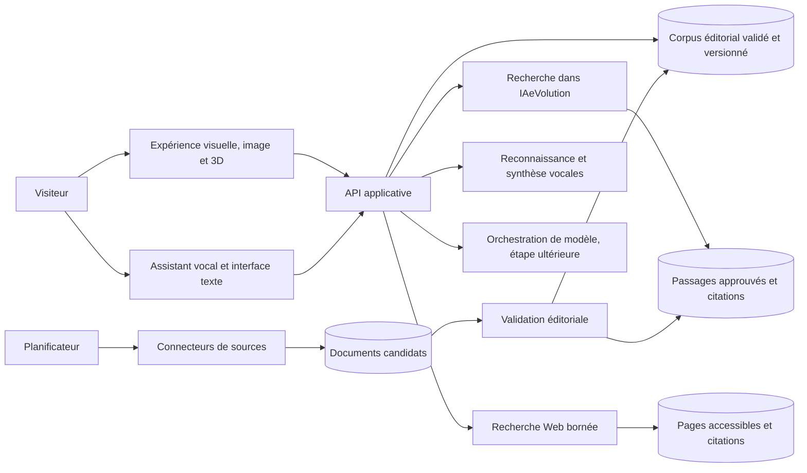

# Cadrage technique

## Objectif et état actuel

IAeVolution est aujourd'hui un site statique servi et construit par Vite. Les dossiers,
les réponses de l'assistant et le catalogue `sources.json` sont éditorialisés dans le
dépôt. Il n'existe ni API, ni base de données, ni collecte programmée, ni appel à un
modèle génératif.

La vision produit est celle d'une expérience visuelle et immersive pour donner à voir
l'IA : images, scènes 3D, robotique, formes et esthétique technologique, en plus des
dossiers éditoriaux. L'assistant à venir sera vocal et permettra d'explorer ensemble le
corpus IAeVolution et des ressources accessibles sur le Web, en gardant les sources et les
limites visibles. L'expérience ne doit pas être réduite à un tableau de bord de veille
textuel.

Le cap technique est donc double : concevoir d'abord un langage visuel distinctif,
accessible et performant ; construire en parallèle des données traçables pour alimenter
les expériences et une recherche multimodale à terme. L'assistant vocal devra interroger
les contenus IAeVolution et rechercher sur le Web quand cela est demandé ou pertinent,
sans prétendre connaître « tout le Web » : les pages non indexées, privées, payantes,
bloquées ou indisponibles resteront hors de portée. Il devra séparer clairement le corpus
éditorial des résultats Web, citer ses sources et signaler ce qu'il ne peut pas vérifier.

La validation éditoriale reste un acte humain ; l'automatisation prépare et signale les
changements, mais ne publie pas de faits sensibles de sa propre initiative.

## Architecture cible, par responsabilités

Ce schéma est logique, pas un choix d'hébergeur ni une architecture déjà déployée. Le
prototype ne doit pas appeler directement un fournisseur de modèle, un moteur de recherche
ou un service vocal nécessitant un secret depuis le navigateur.

### Interface

- Faire évoluer le site vers une expérience éditoriale visuelle : illustrations originales,
  visualisations spatiales et, si elles apportent une vraie compréhension, scènes 3D
  manipulables autour des modèles, centres de données et robots.
- Le prototype associe une maquette CSS 3D manipulable d'un centre de données (rotation,
  quatre zones explicatives et sources) à une vue SVG de repli. La scène SVG de robotique
  propose quatre points d'exploration sourcés : perception, contrôle, action et sécurité ;
  les réseaux restent une scène SVG. Ces maquettes pédagogiques valident le parcours et le
  langage visuel avant l'adoption éventuelle d'un moteur 3D.
- Pour la robotique, distinguer explicitement perception, planification/contrôle, action et
  sécurité ; ne pas laisser entendre que tout robot est piloté par un modèle génératif.
- Conserver une lecture 2D et un parcours textuel complets, une navigation clavier, des
  contrastes adaptés et une alternative aux mouvements/animations. La 3D est une
  amélioration progressive, jamais une condition d'accès au contenu.
- Prévoir une dégradation élégante sur mobiles ou appareils peu puissants : chargement à
  la demande, budget de taille/rendu, pause hors écran et image de remplacement.
- Garder Vite pendant le prototypage visuel ; consommer une API versionnée lorsque les
  contenus éditoriaux sortent du dépôt.
- Rendre explicites les états de chargement, de source indisponible et de corpus incomplet.
- Ne jamais embarquer de secret, clé fournisseur ou identifiant d'accès dans les assets web.

### Catalogue éditorial et historique

`sources.json` constitue le premier contrat de données. À terme, conserver les identifiants
stables, mais séparer les concepts suivants :

| Entité | Rôle et champs clés |
|---|---|
| `Source` | Organisme, famille, sujets couverts, cadence souhaitée, URL autorisées, statut éditorial |
| `SourceDocument` | Document concret : URL, titre, éditeur, date de publication, type, langue et empreinte du contenu |
| `DocumentVersion` | Empreinte, date de collecte, emplacement éventuel du document et changements détectés |
| `Evidence` | Extrait précisément localisable, document/version d'origine, page ou section, statut de validation |
| `EditorialClaim` | Affirmation publiée, portée, unité, période, qualificatif (fait, estimation, projection), preuves associées |
| `ReviewEvent` | Qui a vérifié quoi, quand, décision et commentaire ; journal immuable des validations éditoriales |

`lastReviewedAt` peut rester un résumé pratique dans le catalogue, mais l'historique détaillé
doit provenir des événements de revue. Une date n'est renseignée qu'après une vérification
éditoriale réelle ; la simple réponse HTTP d'un lien ne compte pas comme une revue.

Le stockage relationnel convient aux métadonnées, relations, statuts et événements. Des
documents bruts ou des captures peuvent être placés dans un stockage objet si leur volume
et les droits de conservation le justifient. Il n'est pas nécessaire de choisir ou
d'installer ces services pour le prototype actuel.

### Collecte et validation

1. Lire en priorité les flux RSS, APIs et exports officiellement fournis.
2. À défaut, permettre une collecte manuelle d'une URL ou d'un document autorisé.
3. Enregistrer les métadonnées, l'empreinte et la date de collecte ; conserver l'ancienne
   version au lieu de l'écraser.
4. Comparer les versions et créer une proposition de mise à jour, sans publication
   automatique.
5. Faire vérifier par un éditeur la source primaire, la date, le périmètre, les unités et
   le contexte des affirmations.
6. Publier uniquement les affirmations et extraits approuvés ; journaliser la décision.

Une première collecte planifiée peut être un travail batch simple, limité aux sources
explicitement configurées et avec des tentatives bornées. Une file de messages ou une
orchestration plus complexe ne se justifiera que si le volume, la durée ou la fréquence le
nécessitent. Le scraping généraliste n'est pas le point de départ.

### Recherche et assistant

- **MVP sans génération :** recherche lexicale dans les affirmations et extraits validés,
  réponses éditorialisées avec liens et références exactes. Préparer les résultats sous
  forme de passages citables, sans imposer de modèle.
- **Étape recherche Web :** ajouter un service de recherche configuré qui retourne des
  résultats accessibles avec URL, titre et date disponible ; récupérer seulement des pages
  nécessaires, respecter les politiques et conditions des sites et ne pas contourner un
  accès privé, payant ou bloqué.
- **Étape RAG :** recherche hybride (texte puis sémantique si utile) dans les preuves
  approuvées du corpus, séparément des résultats Web. Le moteur doit conserver les
  identifiants de documents et passages dans chaque résultat.
- **Voix :** l'interface doit accepter la parole et lire les réponses, mais offrir toujours
  texte, sous-titres/transcription, commande d'arrêt et confirmation visuelle. Le choix entre
  capacités natives du navigateur et services vocaux côté serveur est à évaluer selon la
  compatibilité, la confidentialité et les coûts.
- **Génération éventuelle :** appel au modèle depuis l'API serveur ; le modèle ne remplace
  ni le corpus ni la validation des sources.
- Chaque réponse doit distinguer les sources internes des sources Web, citer les passages
  qui l'étayent, afficher les dates disponibles et les qualifications des chiffres, puis
  s'abstenir si les preuves sont insuffisantes ou contradictoires.
- L'ingestion, la recherche interne, la recherche Web, la voix et la génération restent des
  composants indépendants. Cela permet de les évaluer, désactiver ou remplacer sans perdre
  l'accès au site et à ses contenus.

## Contrat minimal de publication

Avant publication, une affirmation chiffrée doit avoir :

- un identifiant stable et une formulation qui ne dépasse pas les preuves ;
- une source primaire ou une justification éditoriale de la source secondaire ;
- un passage localisable (page, section, tableau ou ancre) ;
- une date de publication et une date de vérification, si disponibles ;
- son unité, sa zone géographique, sa période et son périmètre ;
- un type explicite : observation, estimation, projection ou opinion ;
- un validateur et une décision de publication.

Les champs inconnus restent explicitement inconnus ; ne pas les déduire de la date du
commit ou d'une simple collecte automatique.

## Confidentialité, sûreté et fiabilité

- Les questions de l'assistant ne sont pas conservées par défaut ; ne stocker aucune
  conversation sans choix explicite, finalité annoncée et durée de conservation définie.
- Avant l'activation du micro, expliquer la capture vocale et son traitement, demander une
  action claire et offrir une alternative texte. Ne transmettre l'audio à un tiers que si le
  traitement et le fournisseur sont explicitement indiqués.
- Présenter les résultats Web comme des contenus externes non vérifiés par défaut ; séparer
  clairement publicité éventuelle, résultats éditoriaux IAeVolution et résultats de recherche.
- Minimiser les journaux techniques et exclure les questions et contenus personnels des
  traces par défaut.
- Limiter la collecte à des hôtes configurés en HTTPS ; vérifier chaque redirection et
  bloquer les destinations locales ou privées pour prévenir les requêtes côté serveur non
  souhaitées.
- Traiter les documents externes comme des données non fiables, jamais comme des
  instructions. Séparer les passages récupérés des consignes système.
- Limiter les droits d'accès, protéger les secrets côté serveur, borner les tailles et
  durées des collectes, et journaliser les erreurs sans contenu sensible.
- Pour une éventuelle génération : quotas, limitation de débit, plafonds de dépense,
  timeout, contrôle des citations et état de repli en cas d'indisponibilité du fournisseur.

## Étapes proposées

| Étape | Livrable | Critère de sortie |
|---|---|---|
| 1. Prototype d'expérience | Direction visuelle, une scène ou visualisation interactive, alternatives 2D et budgets de performance | La scène est compréhensible, accessible, fluide sur mobile récent et se dégrade proprement sans 3D |
| 2. Contrat éditorial | Schéma versionné des sources, documents, preuves, affirmations et revues | Les données actuelles peuvent être migrées sans inventer de métadonnées |
| 3. Workflow manuel | Ajout, comparaison, revue et publication d'un document candidat | Une mise à jour est retraçable et ne paraît pas avant validation |
| 4. Persistance et API | Catalogue durable, historique et API en lecture seule pour le site | L'interface lit le même contenu publié que l'assistant |
| 5. Recherche évaluée | Corpus approuvé, jeu de questions de référence et mesure des citations | Les réponses pertinentes citent les bonnes preuves et les cas inconnus s'abstiennent |
| 6. Recherche Web contrôlée | Recherche Web explicite ou déclenchée par intention, résultats séparés du corpus interne | Sources accessibles et citées ; aucune affirmation de couverture exhaustive du Web |
| 7. Assistant vocal | Parcours vocal et textuel avec transcription, arrêt, lecture et refus traçable | Le parcours reste utilisable sans micro et fonctionne avec des sources internes et Web distinctes |
| 8. Génération contrôlée | Prototype RAG derrière l'API, désactivable et plafonné | Qualité, confidentialité, coûts et limites sont mesurés avant une ouverture plus large |

## Décisions à prendre avant l'étape 2

Ces décisions ont des conséquences de coût, d'exploitation ou de confidentialité et sont
donc volontairement ouvertes dans ce cadrage :

1. **Hébergement et données :** où héberger l'API et les données, dans quelle région, et
   quelles exigences de résidence ou de conformité appliquer ?
2. **Édition :** qui peut proposer et approuver des modifications, et un seul profil
   éditorial suffit-il pour le premier MVP ?
3. **Collecte initiale :** commencer par une saisie manuelle validée ou développer tout de
   suite un premier connecteur officiel ? Le workflow manuel est recommandé.
4. **Assistant génératif :** quel budget maximal, quelle politique de conservation et quels
   fournisseurs sont acceptables ? Ne pas choisir de modèle avant ces réponses.
5. **Comptes lecteurs :** aucun compte ni historique personnel n'est nécessaire au MVP
   public ; confirmer si des fonctions privées sont envisagées.

## Décisions à prendre pour la nouvelle direction

Ces décisions restent ouvertes jusqu'au prototypage et à des essais utilisateurs :

1. Quelle première scène 3D raconte le mieux l'IA : un centre de données, un réseau de
   modèles, un robot, ou un espace abstrait qui relie ces dimensions ?
2. La voix doit-elle être conversationnelle en continu, ou activée uniquement par un bouton
   « parler » ? Le mode activé à la demande est le meilleur point de départ pour maîtriser
   confidentialité, coût et accessibilité.
3. La recherche Web doit-elle être lancée à chaque question, ou seulement lorsque le corpus
   interne est insuffisant / que la question demande de l'actualité ? Une stratégie hybride
   explicite est recommandée.
4. Quels budgets de performance 3D, de latence vocale et de coût par session sont acceptables ?

**Prochaine tranche recommandée :** faire tester la maquette et son alternative sur mobile
et ordinateur, vérifier les performances, la navigation clavier et la compréhension des
quatre zones, puis décider si un rendu WebGL apporterait une amélioration utile. En
parallèle, conserver le contrat de données et le workflow manuel comme fondation. Ne pas
brancher voix, recherche Web ni modèle avant d'avoir validé les parcours, les exigences de
confidentialité et les budgets avec l'utilisateur.
